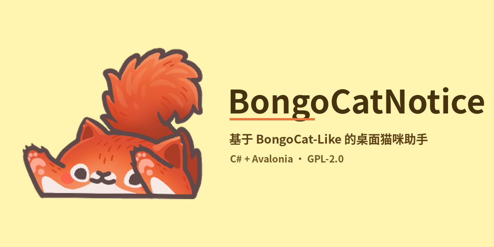
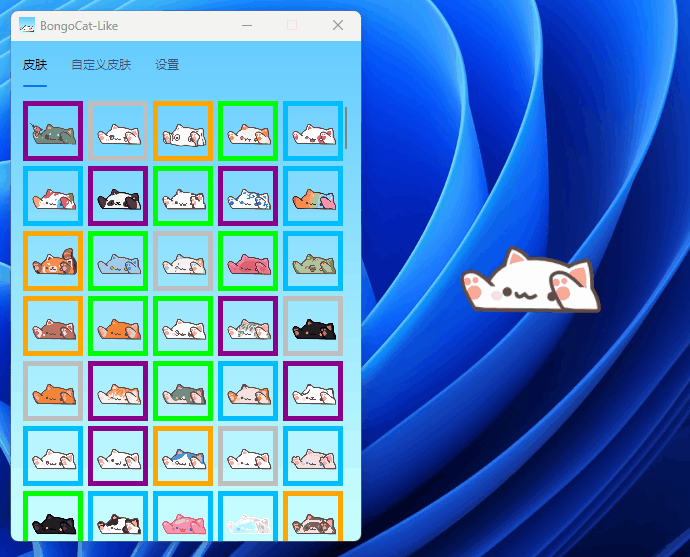

<div align="center">
<h1>🐱 BongoCatNotice</h1>

<p><b>基于 <a href="https://github.com/WLongSAMA/BongoCatLike">BongoCatLike</a> 修改而来的桌面猫咪通知助手</b></p>


</div>

---

> ### 📌 关于本项目的来源
>
> **BongoCatNotice 是基于开源项目 [WLongSAMA/BongoCatLike](https://github.com/WLongSAMA/BongoCatLike) 修改而来的衍生项目。**
>
> 界面骨架、皮肤渲染机制、皮肤与帽子资源均来自 BongoCatLike；本项目在其基础上完成了整体改名、无障碍的窗口定位、敲击响应优化、内存治理与配置持久化，并在此基础上开发通知/提醒能力。
>
> 原项目以 **GPL-2.0** 开源，本项目遵循同一协议（见 [LICENSE.txt](LICENSE.txt)）。**所有上游版权归原作者所有**，详见文末「许可证与致谢」。

<p align="center">
  
  
  
  
</p>

---

## 简介

原项目是一个"会跟着你敲键盘的桌面小猫"——它监听全局键鼠事件，用左右爪的敲击动画回应你的输入。

**BongoCatNotice** 想让它再往前一步：把系统通知、待办、定时提醒这类信息，交给一只会敲桌子的小猫递到你面前，而不是再弹一个冷冰冰的横幅。

设计原则：**不打扰**（托盘常驻、透明无边框、可鼠标穿透）、**轻**（不依赖 Steam、不联网、空闲近零占用）、**可换装**（227 套皮肤 + 387 顶帽子开箱可用）。

> 当前状态：项⽬骨架已从上游独立并完成整体改名，**notice（通知/提醒）功能开发中**，现有能力为完整可用的桌面猫咪。

## 功能特性

- 🖥️ **跨平台**：Windows / Linux / macOS
- 🪶 **极轻量**：不依赖 Steam、不联网，Native AOT 单文件发布
- 🎨 **227 套皮肤 + 387 顶帽子**，支持自定义皮肤（纯 PNG + JSON，无需编译）
- ⌨️ **键盘 / 鼠标敲击互动**：任意按键都会触发敲击动画，左右爪交替
- ⚡ **快速连击不丢帧**：事件驱动切换，取消动画排队，60ms 最短可见时长
- 🖱️ **鼠标穿透 / 置顶 / 托盘 / 拖拽 / 缩放 / 翻转 / 呼吸动画**
- 🔁 **随机换装**：60s / 3min / 5min / 15min / 30min
- ⌨️ **全局快捷键 Ctrl+Y**：任何应用中按下即可打开设置面板
- 🌐 **多语言界面**

## 演示

<p align="center">
  
</p>

## 快捷键

| 快捷键 | 作用 | 说明 |
|---|---|---|
| `Ctrl` + `Y` | 打开 / 聚焦设置面板 | 全局生效，任意应用下可用；字母可在设置页改为 `U / I / O / P / L` |

> 说明：不接受 `Ctrl+C` 这类高频系统快捷键，避免与"复制"等操作冲突。

## 快速开始

### 直接使用

到 [Releases](../../releases) 下载对应平台压缩包，解压后运行 `BongoCatNotice`（Windows 为 `.exe`）。

Windows 首次运行若提示"未知发布者"，为未签名程序的正常现象，选择「更多信息 → 仍要运行」即可。

### 从源码运行

需要 **.NET 10 SDK**：

```bash
dotnet run -c Release
```

### 构建发布包

```bash
# Windows x64 单文件
dotnet publish ./BongoCatNotice.csproj -c Release -r win-x64
```

产物在 `bin/Release/net10.0/win-x64/publish/`。

> Release 配置启用 Native AOT，需要 MSVC 工具链（Visual Studio「使用 C++ 的桌面开发」工作负载）。若未安装，可加 `-p:PublishAot=false` 使用普通自包含发布。

Windows 用户也可以直接双击仓库里的 `build.bat` / `run.bat`。

## 皮肤系统

皮肤是**分层素材**，一套由 5 个 256×256 PNG 组成：

| 文件 | 内容 |
|---|---|
| `XxxLeft.png` | 猫头 + 身体 + 左爪（静止） |
| `XxxLeftPunch.png` | 猫头 + 身体 + 左爪（按下） |
| `XxxRight.png` | 右爪（静止），单独一层 |
| `XxxRightPunch.png` | 右爪（按下） |
| `XxxIcon.png` | 设置面板图标 |

在 `Assets/items.json` 注册后重新编译即可出现在列表里。完整步骤（四帧对齐规范、字段说明、帽子制作、常见问题）见：

📖 **[自定义皮肤教程](docs/custom-skin-guide.md)** —— 含 227 套官方皮肤的**实测坐标规范**（包围盒、抬爪行程 40px）与自检脚本用法。

画完先跑一遍自检，能提前发现对齐问题：

```bash
python Tools/check_skin.py --prefix Assets/skin/MyCat
```

## 项目结构

```
BongoCatNotice/
├── Program.cs                  # 入口
├── app.manifest                # DPI / 单实例清单
├── Views/                      # 主窗口、设置窗口、App
├── ViewModels/                 # 设置面板视图模型
├── Utilities/                  # 皮肤/配置/本地化/窗口工具
├── Locales/                    # 多语言文案
├── Assets/
│   ├── skin/                   # 227 套皮肤（每套 4 帧 + 图标）
│   ├── hat/                    # 387 顶帽子
│   ├── emote/ animate/ consumable/ default/
│   ├── items.json              # 皮肤/帽子清单
│   ├── offset.json             # 帽子挂载偏移
│   └── Icon.ico                # exe / 任务栏 / 托盘图标
├── docs/
│   ├── design.md               # 设计说明
│   ├── custom-skin-guide.md    # 自定义皮肤教程
│   └── cover.png               # 项目封面
├── screenshots/                # 演示与截图
└── .github/workflows/          # 多平台自动构建与发布
```

📐 更深入的内容（模块职责、敲击事件流、窗口位置补偿、内存治理、设计取舍）见 **[设计说明](docs/design.md)**。

## 常见问题

<details>
<summary><b>猫挡住我点下面的窗口了？</b></summary>

设置面板里开启「鼠标穿透」，鼠标事件会直接穿到下层窗口；也可以用「改变大小」之外的设置调整窗口边缘贴合度——窗口大小是按不透明像素包围盒计算的，边缘不会有透明空白区挡点击。
</details>

<details>
<summary><b>为什么换装时猫会动一下？</b></summary>

不同装扮的包围盒高度不同（默认皮肤 148px，加上帽子可能到 250px+）。本项目以**底部 + 水平中心**为锚点补偿窗口位置，保证换装时脚不动、左右对称扩展。
</details>

<details>
<summary><b>快速连击时动画跟不上？</b></summary>

已在 0.1.1.0 修复：取消 200ms 动画排队，改为按下即切帧、松开后保留 60ms 最短可见时长，并用版本号保证等待期间的新输入不被覆盖。
</details>

<details>
<summary><b>能加 Steam 版的其他皮肤吗？</b></summary>

Steam 版 BongoCat 是付费游戏，其内置皮肤与装扮属于该游戏资产，本项目不提供也不建议提取。你可以用 [自定义皮肤教程](docs/custom-skin-guide.md) 自己做，或使用社区以开放许可发布的素材。
</details>

## 路线图

- [ ] **notice 核心**：统一接收系统通知 / 待办 / 定时提醒
- [ ] 通知样式：气泡、举牌、敲桌子节奏区分优先级
- [ ] 免打扰时段与优先级规则
- [ ] 皮肤制作辅助工具：四帧对齐检查

## 贡献

欢迎提交 Issue 与 PR。提交前请阅读 [CONTRIBUTING.md](CONTRIBUTING.md)。

## 许可证与致谢

本项目是 **[WLongSAMA/BongoCatLike](https://github.com/WLongSAMA/BongoCatLike)** 的修改版本，遵循上游 **GPL-2.0** 协议发布（见 [LICENSE.txt](LICENSE.txt)）。

- 上游项目：BongoCatLike —— 作者 **WLongSAMA** 及所有贡献者
- 上游的上游：Steam 版 [Bongo Cat](https://store.steampowered.com/app/3419430/Bongo_Cat)（部分图像资源的版权归原作者所有）
- 本项目在原项目基础上所做的修改，见 [changelog.md](changelog.md)

**开源义务**：依据 GPL-2.0，任何基于本项目的衍生作品同样必须以 GPL-2.0 开放源代码，并保留上述版权声明。

感谢上游作者与所有社区贡献者提供的优秀基础。
