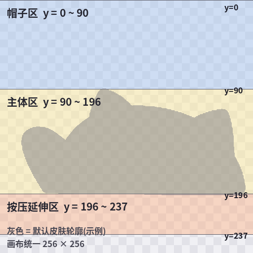
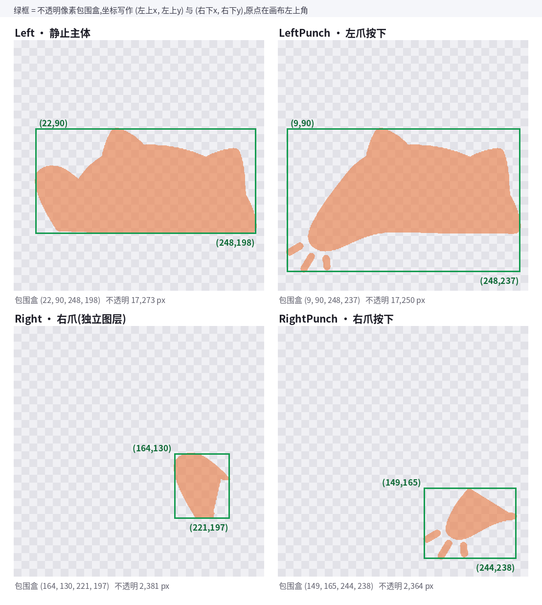
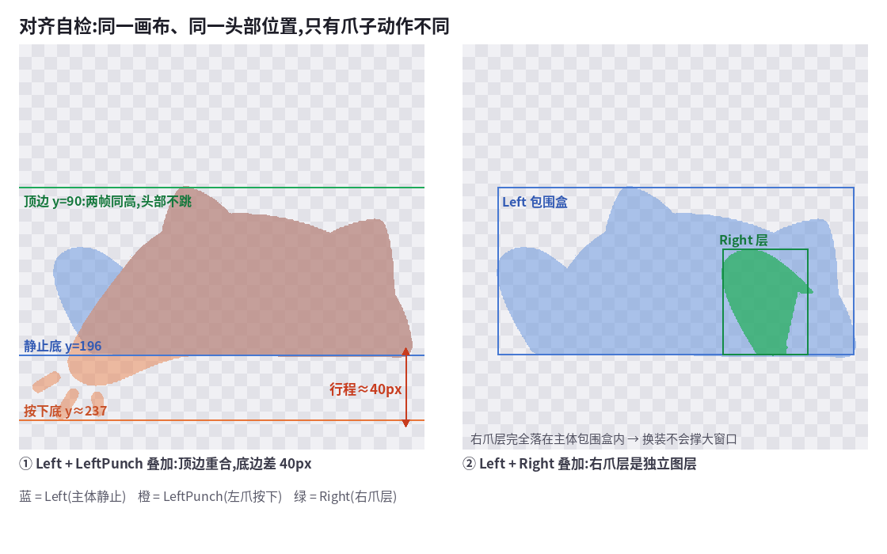
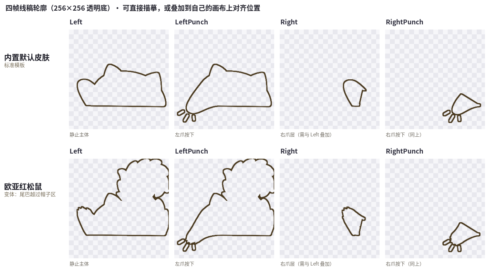

# BongoCatNotice 自定义皮肤教程

> 适用项目：BongoCatNotice（基于 WLongSAMA/BongoCatLike，C# + Avalonia）
> 本文基于源码 `main` 分支整理，包含资源机制、四帧规范、items.json 注册、编译验证与常见问题。

---

## 0. 先搞懂原理（很重要）

这个程序的皮肤**不是**放在某个文件夹里运行时扫描加载的，而是作为 **Avalonia 资源（`avares://`）编译进程序集**的：

```xml
<!-- BongoCatNotice.csproj -->
<AvaloniaResource Include="Assets\**" />
```

也就是说：

- 图片放在 `Assets/` 下就会被打包进 exe；
- **改完图片或 `items.json` 后，必须重新编译才生效**；
- 当前版本不支持「把皮肤丢进外部文件夹就能用」的热加载方式。

一套皮肤 = **4 张动作帧 + 1 张图标 + `Assets/items.json` 里的一条记录**。

---

## 1. 准备素材

### 1.1 格式要求

| 项目 | 要求 |
|---|---|
| 格式 | PNG，RGBA（带透明通道） |
| 尺寸 | **严格 256 × 256 像素**（四帧都必须一致） |
| 背景 | 透明 |
| 色彩 | 普通 RGBA 即可，不要带白底/黑底 |

> 为什么必须 256×256：程序用图片像素坐标计算「不透明像素包围盒」来决定窗口大小，尺寸不一致会导致窗口裁剪和显示错位。

### 1.2 四帧分别画什么

一套皮肤需要 4 张图，顺序和图层关系如下：

| 顺序 | 建议文件名 | 内容 | 图层 |
|---|---|---|---|
| 1 | `XxxLeft.png` | 猫头 + 左爪，**静止** | 主体层 |
| 2 | `XxxLeftPunch.png` | 猫头 + 左爪，**敲击** | 主体层 |
| 3 | `XxxRight.png` | 右爪，**静止** | 手部层 |
| 4 | `XxxRightPunch.png` | 右爪，**敲击** | 手部层 |

关键理解：

- **第 1 张和第 3 张是同时叠加显示的**（`SkinImage` + `HandImage` 两个图层），不是二选一；
- 第 2、4 张是敲键盘/鼠标时短暂替换的「按下」帧；
- 所以画的时候要**分层**：`Left` 画猫头和左爪，`Right` 只画右爪，不要把整只猫重复画两遍。

### 1.3 对齐要求（最容易翻车的地方）

1. **四帧必须在同一个 256×256 坐标系里绘制**：猫头/身体的位置要完全一致，只有爪子的动作不同。
2. **不要贴边**：四周至少留几像素透明边，否则程序按不透明包围盒裁切后，窗口会紧贴猫，缩放时容易出问题。
3. 左右爪的动作帧只改爪子，不要顺带移动头部或身体，否则敲击动画会「抖」。

### 1.4 图标

- 设置面板里以 50×50 显示，建议直接给 **256×256 方形 PNG**，缩放后最清晰；
- 图标内容随意，通常是猫头特写。

---

## 2. 把图片放进项目

把 5 个文件放到：

```
Assets/skin/
```

例如：

```
Assets/skin/MyCatLeft.png
Assets/skin/MyCatLeftPunch.png
Assets/skin/MyCatRight.png
Assets/skin/MyCatRightPunch.png
Assets/skin/MyCatIcon.png
```

命名建议：

- 用英文/数字，避免空格和中文（跨平台最稳）；
- **大小写必须和 JSON 里完全一致**（Linux 下路径大小写敏感）；
- 不要覆盖现有文件，除非你就是想替换某套皮肤。

---

## 3. 在 items.json 里注册

打开 `Assets/items.json`，找到顶层的 `"skin"` 对象，在里面新增一条记录。

### 3.1 完整示例

```json
"9001": {
  "name": "My Cat",
  "description": "我的第一套自定义皮肤",
  "modified": "20261017T000000Z",
  "created": "20261017T000000Z",
  "icon": "MyCatIcon.png",
  "image": [
    "MyCatLeft.png",
    "MyCatLeftPunch.png",
    "MyCatRight.png",
    "MyCatRightPunch.png"
  ],
  "tags": "quality:common"
}
```

### 3.2 字段说明

| 字段 | 说明 |
|---|---|
| `"9001"`（key） | 皮肤唯一 ID，字符串。现有 ID 范围约 225–1007，自定义建议用 **9001 以上**，避免冲突；`"0"` 是内置默认皮肤，不要占用 |
| `name` | 设置面板里鼠标悬停显示的名字 |
| `description` | 描述文字（当前版本界面未展示，但字段必填） |
| `modified` / `created` | 时间戳字符串，格式如 `20261017T000000Z`；程序不解析，但不能缺 |
| `icon` | 图标文件名，对应 `Assets/skin/` 下的文件 |
| `image` | **固定 4 个字符串，顺序必须是** `[Left, LeftPunch, Right, RightPunch]` |
| `tags` | 品质标签，决定设置面板边框颜色 |

### 3.3 tags 可选值

| tags | 边框颜色 |
|---|---|
| `quality:common` | 银灰 |
| `quality:uncommon` | 亮绿 |
| `quality:rare` | 天蓝 |
| `quality:epic` | 暗紫 |
| `quality:legendary` | 橙色 |
| `quality:unique` | 洋红 |
| 其他 / 空 | 透明（无边框，仍可用） |

> 可以带后缀，例如 `quality:rare;event:myevent`，程序只做 `Contains("quality:rare")` 判断。

### 3.4 JSON 语法注意

- 新条目和前一条目之间要有**逗号**；
- 所有字段都是必填（`required`），少字段会导致反序列化失败、程序无法启动；
- 建议改完用编辑器的 JSON 校验或在线格式化工具检查一遍。

---

## 4. 重新编译

### 直接运行看效果

```
cd BongoCatNotice
```

```
dotnet run -c Release
```

### 打包成 exe

```
dotnet publish ./BongoCatNotice.csproj -c Release -r win-x64
```

产物：

```
bin\Release\net10.0\win-x64\publish\
```

> 再次强调：**只改图片、不重新编译，是不会生效的**。资源已经嵌进旧的程序集里了。

---

## 5. 验证

1. 启动程序，右键任务栏托盘图标 → 「皮肤」/「设置」；
2. 在皮肤列表里找到你的皮肤（名字来自 `name` 字段）；
3. 点击选中，猫应立即换装；
4. 敲几下键盘，观察左爪/右爪的敲击动画是否正常；
5. 反复切换几套皮肤，检查猫的位置是否稳定（本项目已修复换装时的窗口偏移问题）。

---

## 6. 进阶：自定义帽子

帽子的流程类似，但更简单。

### 6.1 放图片

```
Assets/hat/MyHat.png
Assets/hat/MyHatIcon.png
```

- 帽子 PNG 尺寸**不要求 256×256**，可以是任意尺寸（建议不超过 256）；
- 透明背景；
- 帽子会被叠加到 256×256 的猫画布上。

### 6.2 注册到 items.json

在 `"hat"` 对象里新增：

```json
"9002": {
  "name": "My Hat",
  "description": "我的自定义帽子",
  "modified": "20261017T000000Z",
  "created": "20261017T000000Z",
  "icon": "MyHatIcon.png",
  "image": "MyHat.png",
  "tags": "quality:common"
}
```

注意帽子的 `image` 是**单个字符串**，不是数组。

### 6.3 调整帽子位置（可选）

默认帽子贴图偏移是 `(x: 30, y: -70)`（相对 256×256 画布左上角，y 为负表示向上超出画布）。

如需单独调整，编辑 `Assets/offset.json`，它按帽子的 `name` 匹配：

```json
[
  {
    "name": "My Hat",
    "position": { "x": 30, "y": -70 }
  }
]
```

- `x` 越大越靠右，`y` 越大越靠下；
- 数组里没有匹配到的帽子，统一使用默认 `(30, -70)`。

---

## 7. 常见问题（FAQ）

**Q1：设置里看不到新皮肤？**
- `items.json` 语法错误（多/少逗号、引号不配对）；
- 皮肤 ID 和现有条目冲突；
- 没有重新编译。

**Q2：皮肤出现在列表里，但选中后一片空白 / 程序异常？**
- 图片全透明（包围盒为 0）；
- 图片不是 256×256；
- `image` 里的文件名和实际文件大小写/后缀不一致；
- 图片不在 `Assets/skin/` 下。

**Q3：换装后猫的位置上下/左右跳？**
- 本项目已修复窗口位置补偿；
- 如果仍有轻微跳动，多半是四帧画布内的主体没有对齐，或某帧的不透明包围盒差异过大（检查是否贴边、是否有杂物像素）。

**Q4：敲击时猫头或身体抖动？**
- `Left`/`LeftPunch` 或 `Right`/`RightPunch` 两帧的主体位置没对齐。用图层叠加对比，确保除了爪子之外完全重合。

**Q5：图标模糊 / 变形？**
- 用 256×256 方形 PNG；非方形的图在 50×50 框里会被拉伸或留白。

**Q6：能不能不重新编译，直接放文件夹加载皮肤？**
- 当前版本不能。皮肤是编译期资源（`avares://`），必须重新构建程序。

**Q7：只想改现有皮肤，不想新增？**
- 直接覆盖 `Assets/skin/` 下对应文件（先备份），保持文件名不变，重新编译即可，无需改 `items.json`。

---

## 8. 速查流程

```
1. 画 4 张 256×256 透明 PNG（Left / LeftPunch / Right / RightPunch）+ 1 张 Icon
2. 放进 Assets/skin/
3. 在 Assets/items.json 的 "skin" 里加一条记录（ID 用 9001+）
4. dotnet run -c Release 或 dotnet publish
5. 托盘 → 设置 → 选择新皮肤 → 敲键盘验证
```

---

## 9. 坐标规范：画到和原版一样的位置

这一节是第 1.3 节「对齐要求」的量化版本。下面的数字来自对项目内置 **227 套官方皮肤**的实际统计，不是估算。

### 9.0 本节用的两套示例皮肤

教程全程用两套皮肤举例，它们分别代表"标准"和"允许的变体"：

| | 内置默认皮肤 `Cat*` | 欧亚红松鼠 `EurasianRedSquirrel*` |
|---|---|---|
| 定位 | **标准模板**，各项数值都贴着共识值 | **变体**，尾巴顶到画布上沿、身体更宽 |
| `Left` 包围盒 | `(22, 90) – (248, 198)` | `(20, 0) – (256, 197)` |
| `LeftPunch` 包围盒 | `(9, 90) – (248, 237)` | `(9, 0) – (256, 237)` |
| `Right` 包围盒 | `(164, 130) – (221, 197)` | `(160, 125) – (219, 197)` |
| 顶边 | `y = 90`（猫头刚好在帽子区下方） | `y = 0`（尾巴占用了帽子区） |
| 结论 | 照这个画最稳 | **这样画也能用**，帽子和尾巴不会打架 |

**关于图层顺序**（决定了这些元素怎么叠，见 `Views/MainWindow.axaml`）：

| 层 | 控件 | 内容 |
|---|---|---|
| 底层 | `SkinImage` | 主体 + 左爪（尾巴也在这一层） |
| 中间 | `HatImage` | 帽子 |
| 顶层 | `HandImage` | 右爪 |

所以帽子会**盖在尾巴上面**——尾巴伸进帽子区也不会冲突，观感上依然是"戴在头上"，只是尾巴尖会被帽檐遮住一小块。反过来，敲击时右爪会盖在帽子前面。

> 记住：模板是**参考**不是硬性限制。第二套说明——偏离模板不会让程序出错，只是观感上会有取舍。想稳妥就贴标准值，想有特色就接受这些副作用。

---

### 9.1 画布分区

```
y = 0  ┌─────────────────────────┐
       │                         │  ← 这 90px 是帽子区
       │      (留空 / 透明)       │     猫头不要超过 y≈85
y = 90 ├─────────────────────────┤
       │   猫头 + 身体 + 左爪     │
y = 196├─────────────────────────┤  ← 静止时爪子底部
       │   按下时爪子延伸到此     │
y = 237└─────────────────────────┘
```



### 9.2 四帧的标准包围盒

| 帧 | 典型包围盒 (x0, y0, x1, y1) | 面积 |
|---|---|---|
| `Left` 静止主体 | `(22, 90) – (247, 196)` | ≈ 17,274 px（填充率 71%） |
| `LeftPunch` 左爪按下 | 共识 `(16, 90) – (247, 228)`，最大 `(9, 90) – (247, 236)` | — |
| `Right` 右爪静止（独立图层） | `(164, 129) – (218, 196)` | ≈ 2,339 px |
| `RightPunch` 右爪按下 | `(149, 166) – (242, 237)` | — |



> 图中数值取自内置默认皮肤的实际测量结果，与上表的"标准值"可能相差 1~2px，属正常范围。

**抬爪行程**：静止底边 y ≈ 196，按下底边 y ≈ 236–237，**约 40px**。

这条 40px 就是敲击动画的"力度感"来源——短了像抽搐，长了像砸键盘。

### 9.3 这些数字有多可信

- 227 套中 **41.4%** 的皮肤 `Left` 包围盒与 `(22,90,247,196)` **逐像素一致**
- **63.9%** 的 `LeftPunch` 包围盒与 `(9,90,247,236)` 一致
- 与默认皮肤的轮廓 IoU **中位数 0.9863**，157/227（69%）≥ 0.95

也就是说，227 套官方皮肤基本是**同一套猫轮廓 + 换色/换贴图/加小配饰**，而不是各自独立绘制。按上表的位置画，就能自然融入原版。

### 9.4 实操建议

| 要求 | 建议值 |
|---|---|
| 方向 | 猫头朝左，身体向右侧展开（原版统一构图） |
| 水平中心 | x ≈ 134.5（左右对称时） |
| 头顶 | y ≈ 90，**不要高于 85**（会顶进帽子区，戴帽子时穿模） |
| 爪子静止底 | y ≈ 196 |
| 爪子按下底 | y ≈ 236 |
| 四周留白 | 左 ≥ 9px、右 ≥ 9px、上 ≥ 85px、下 ≥ 19px |

### 9.5 对齐检查示意



- **左图**：`Left` 与 `LeftPunch` 叠加。顶边必须**完全重合**（否则敲击时头部会跳），底边相差 **约 40px** —— 这就是敲击行程。
- **右图**：`Right` 是独立图层，它的包围盒应**完全落在** `Left` 的包围盒内。若超出，窗口会被撑大，换装时猫的位置就会漂移。

### 9.6 线稿模板（可直接拿去用）

上面两套示例皮肤的四帧线稿已经导出成独立文件，**256×256、透明底、深棕描边**，可以直接当描摹底稿：



文件位置：`docs/images/outline/`

| 文件 | 内容 |
|---|---|
| `outline_Default_Left.png` | 默认皮肤 · 静止主体 |
| `outline_Default_LeftPunch.png` | 默认皮肤 · 左爪按下 |
| `outline_Default_Right.png` | 默认皮肤 · 右爪层 |
| `outline_Default_RightPunch.png` | 默认皮肤 · 右爪按下 |
| `outline_RedSquirrel_Left.png` | 红松鼠 · 静止主体（含大尾巴） |
| `outline_RedSquirrel_LeftPunch.png` | 红松鼠 · 左爪按下 |
| `outline_RedSquirrel_Right.png` | 红松鼠 · 右爪层 |
| `outline_RedSquirrel_RightPunch.png` | 红松鼠 · 右爪按下 |

**推荐用法**：

1. 新建 256×256 透明画布
2. 把对应线稿作为最上层导入，不透明度调到 **25%~35%**
3. 在下面新建图层描摹上色
4. 完成后隐藏/删掉线稿图层，导出 PNG-24（保留透明通道）
5. 四帧都用**同一份线稿**（不要各自移动底稿），保证头部位置一致

> `Right` / `RightPunch` 只是右爪，单独看会认不出是什么——这是分层设计决定的，画的时候把它当成"叠在 `Left` 上的第二层"来看。

---

## 10. 自检脚本

项目自带一个校验工具，能在编译前就把对齐问题查出来：

```
Tools/check_skin.py
```

### 10.1 用法

```bash
# 四帧一起检查（推荐）
python Tools/check_skin.py Assets/skin/MyCatLeft.png Assets/skin/MyCatLeftPunch.png \
                          Assets/skin/MyCatRight.png Assets/skin/MyCatRightPunch.png
```

```bash
# 也支持按前缀自动找四帧
python Tools/check_skin.py --prefix Assets/skin/MyCat
```

### 10.2 它会检查什么

| 检查项 | 说明 |
|---|---|
| 尺寸 | 必须 256×256 |
| 色彩模式 | 必须带 alpha 通道 |
| 是否全透明 | 全透明会导致窗口尺寸为 0，程序看不到猫 |
| 包围盒 | 打印实际 bbox，并与模板对比给出偏差 |
| 四帧对齐 | `Left` 与 `LeftPunch` 的顶边必须一致（否则敲击时头会跳） |
| 图层包含关系 | `Right` 应完全落在 `Left` 的包围盒内 |
| 底部深色条 | 检测是否缺少原版那条"桌面线"（可选，仅提示） |

输出示例：

```
[1/4] MyCatLeft.png
      size 256x256 OK   mode RGBA OK
      bbox (22, 90, 247, 196)  area 17274  模板偏差 dx0=0 dy0=0 dx1=0 dy1=0  [MATCH]
[2/4] MyCatLeftPunch.png
      bbox (22, 90, 247, 237)  ...
      ...
== 结论 ==
  PASS: 4 项检查通过
  WARN: LeftPunch 顶边(90) 与 Left(90) 一致 OK
```

有 `FAIL` 的项一定要改，`WARN` 通常是风格问题，可按需忽略。

> 需要 Python 3 与 Pillow：`pip install pillow`

---

## 11. 常见翻车点（实测）

| 现象 | 原因 | 处理 |
|---|---|---|
| 换装时猫上下跳 | 两套皮肤包围盒高度差大（可差 100px） | 程序已按「底部+中心」锚点补偿；若仍明显，检查是否有多余的半透明像素把包围盒撑大 |
| 敲击时头部抖一下 | 四帧的头部位置不一致 | 用同一份底图复制四帧，**只改爪子** |
| 猫变得特别大/小 | 图片不是 256×256，或内容画得过大 | 重新导出，内容控制在 9.4 的范围内 |
| 列表里显示空白方块 | 图片全透明 / 路径大小写不符 | 用自检脚本查 alpha；Linux 下大小写敏感 |
| 皮肤边缘发白、发糊 | 导出时带了白底，或用了 JPG 有损压缩再转 PNG | 直接导出 **PNG-24 + 透明通道**，不要过 JPG |
| 底部有一条深色横线 | 这是原版设计（猫身下的桌面/阴影） | **保留**。227 套里 38/40 抽样都有，去掉反而不协调 |
| 戴帽子后帽子位置不对 | 帽子偏移按 `name` 匹配 `offset.json` | 见第 6.3 节，给帽子单独配 `position` |
| 改了图片但没变化 | 资源编译进程序集了 | 必须重新 `dotnet run` / `publish` |

---

## 12. 素材来源与授权

- ✅ **自制素材**、**明确开放许可**（MIT / CC0 / CC-BY / 公有领域）的素材
- ❌ **商业游戏内置素材**：Steam 版 Bongo Cat 的皮肤、其它游戏解包资源——这些是付费内容，不能随本项目分发
- 使用他人素材时，请在 `docs/THIRD_PARTY_NOTICES.md` 记录：素材名、作者、许可、原始链接

本项目以 **GPL-2.0** 发布，你新增的皮肤资源同样受该协议约束（除非素材自身许可另有要求，此时以更严格者为准）。

---

## 13. 完整流程（含自检）

```
1. 画 4 张 256×256 透明 PNG + 1 张 Icon
   └─ 位置参考第 9 章：头顶 y≈90、爪子底 y≈196、按下 y≈236
2. 放进 Assets/skin/
3. 跑 Tools/check_skin.py 自检，修掉所有 FAIL
4. 在 Assets/items.json 的 "skin" 里注册（ID 用 9001+）
5. dotnet run -c Release 看效果
6. 托盘 → 设置 → 选皮肤 → 敲键盘验证左右爪
7. 反复切换几套皮肤，确认猫的位置稳定
```

---

## 14. 免编译热加载（外部皮肤目录）

从 0.1.0.5 起，**不必再改 `Assets/` 重新编译**：把皮肤放进用户目录，重启程序就能在列表里看到。

### 14.1 目录位置

| 平台 | 路径 |
|---|---|
| Windows | `%AppData%\BongoCatNotice\skins\` |
| Linux | `~/.config/BongoCatNotice/skins/` |
| macOS | `~/Library/Application Support/BongoCatNotice/skins/` |

首次启动会自动创建这个目录。

### 14.2 每套皮肤一个子目录

```
skins/
└── MyCat/
    ├── skin.json
    ├── MyCatLeft.png
    ├── MyCatLeftPunch.png
    ├── MyCatRight.png
    ├── MyCatRightPunch.png
    └── MyCatIcon.png
```

`skin.json`：

```json
{
  "name": "My Cat",
  "description": "",
  "modified": "20261018T000000Z",
  "created": "20261018T000000Z",
  "icon": "MyCatIcon.png",
  "image": ["MyCatLeft.png", "MyCatLeftPunch.png", "MyCatRight.png", "MyCatRightPunch.png"],
  "tags": "quality:common"
}
```

规则：

- `image` 顺序必须是 **Left / LeftPunch / Right / RightPunch**
- 四张图必须都存在，缺一张这套皮肤会被**静默跳过**（不影响其它皮肤）
- 名字可以重复，内部 ID 用目录名区分（`ext_MyCat`）
- 需要重启程序生效（列表在启动时扫描）
- `skin.json` 写坏也只是跳过这一套，不会影响程序启动

### 14.3 和"编译进程序集"的区别

| | 内嵌皮肤（`Assets/skin/`） | 外部皮肤（`skins/`） |
|---|---|---|
| 生效方式 | 重新编译 | 放入目录后重启 |
| 适合 | 项目自带资源、要分发给所有人 | 自己用、临时试做、不想装 SDK |
| 分布 | 随 exe 一起 | 只在本机 |

---

## 附：最小可用条目模板

```json
"9001": {
  "name": "My Cat",
  "description": "",
  "modified": "20261017T000000Z",
  "created": "20261017T000000Z",
  "icon": "MyCatIcon.png",
  "image": [
    "MyCatLeft.png",
    "MyCatLeftPunch.png",
    "MyCatRight.png",
    "MyCatRightPunch.png"
  ],
  "tags": "quality:common"
}
```

